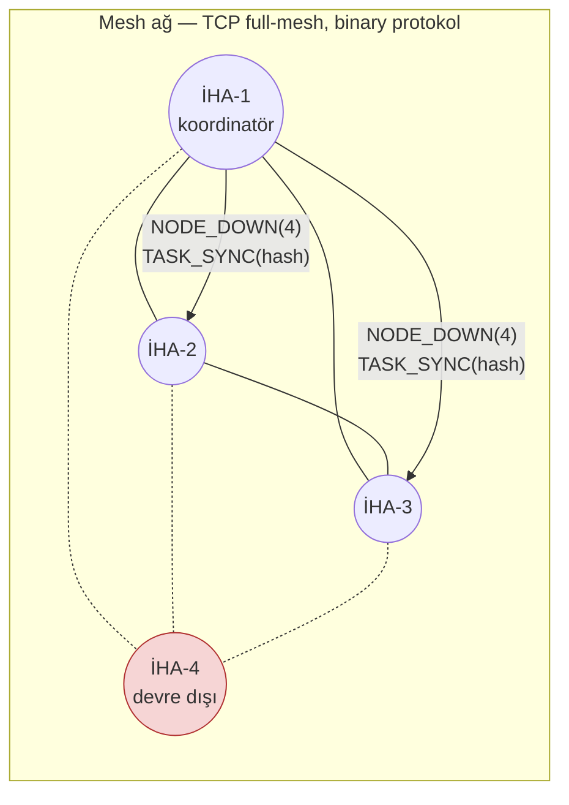
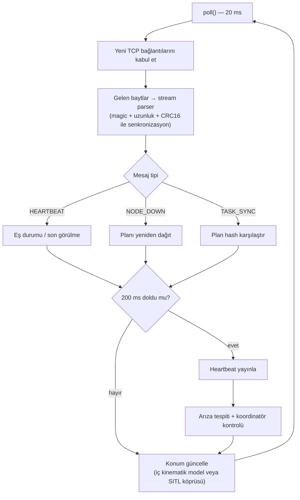
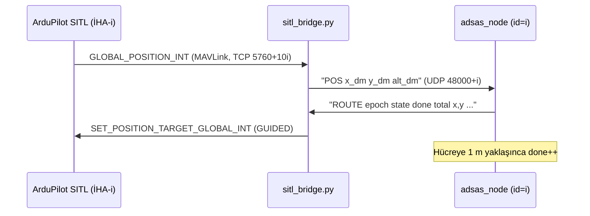

# A.D.S.A.S. Core — Sürü İHA Dağıtık Haberleşme Mimarisi


> **Elektronik harp (jamming) ve GPS kesintisi** altında, yer istasyonuyla bağlantısı kopan bir İHA sürüsünün
> görevi **merkeze bağlı kalmadan** sürdürebilmesi için tasarlanmış dağıtık haberleşme ve görev
> paylaşım çekirdeği.

| | |
|---|---|
| **Proje türü** | Bireysel proje |
| **Ortam** | Simülasyon (Gazebo + ArduPilot SITL) — *gerçek uçuş testi değildir* |
| **Rolüm** | Fikirden simülasyona tüm süreç: senaryo, protokol, C kodu, algoritma, simülasyon |
| **Diller** | C (çekirdek), Python (SITL köprüsü ve araçlar), Bash |

---

## İçindekiler
1. [Problem](#1-problem)
2. [Çözüm Özeti](#2-çözüm-özeti)
3. [Sistem Mimarisi](#3-sistem-mimarisi)
4. [Binary Protokol](#4-binary-protokol)
5. [Arıza Tespiti ve Yeniden Görev Dağıtımı](#5-arıza-tespiti-ve-yeniden-görev-dağıtımı)
6. [Depo Yapısı](#6-depo-yapısı)
7. [Kurulum ve Çalıştırma](#7-kurulum-ve-çalıştırma)
8. [Testler](#8-testler)
9. [Tasarım Kararları](#9-tasarım-kararları)
10. [Sınırlamalar ve Gelecek Çalışmalar](#10-sınırlamalar-ve-gelecek-çalışmalar)

---

## 1. Problem

Klasik bir İHA görevinde her araç **yer kontrol istasyonu (YKİ)** ile yıldız topolojide haberleşir.
Elektronik harp ortamında:

* YKİ linki **karıştırılabilir (jamming)** → araçlar komut alamaz,
* **GPS** bozulabilir → konum bilgisi güvenilmez hale gelir,
* bir İHA **düşerse/kaybolursa** onun görev alanı kapsamsız kalır.

Hedef: sürüdeki İHA'ların **birbirleriyle doğrudan** konuşması ve bir İHA devre dışı kaldığında
görev yükünün **kalan İHA'lara otomatik paylaştırılması**.

## 2. Çözüm Özeti

| Bileşen | Ne yapar |
|---|---|
| **Mesh (dağıtık) ağ** | Her düğüm diğer tüm düğümlerle doğrudan TCP bağlantısı kurar; tek merkeze bağımlılık yoktur. |
| **Düşük genel giderli binary protokol** | 12 B başlık + yük + 2 B CRC16. Heartbeat çerçevesi **31 bayt** (JSON eşdeğeri 184 bayt → **~6x küçük**). |
| **C `struct` paketleme** | `#pragma pack(1)` yapıları wire formatını belgeler, `_Static_assert` ile boyutları derleme anında doğrulanır. |
| **Heartbeat tabanlı arıza tespiti** | 200 ms periyot, 1000 ms (5 kayıp heartbeat) zaman aşımı. |
| **Koordinatör seçimi** | Ek mesaj gerektirmeyen kural: *canlı ve şüpheli olmayan en küçük ID* koordinatördür. |
| **Deterministik yeniden görev dağıtımı** | Kayıp İHA'nın tamamlanmamış hücreleri maliyet fonksiyonuyla kalan İHA'lara dağıtılır; her düğüm aynı sonucu bulur, **plan hash** ile tutarlılık kontrol edilir. |
| **İzolasyon koruması** | Hiçbir eşi duyamayan düğüm "sorun bende (jamming)" varsayar, sürüyü dışlamaz, kendi rotasına otonom devam eder. |

## 3. Sistem Mimarisi



Her İHA üzerinde çalışan yazılım (`adsas_node`) tek iş parçacıklı bir olay döngüsüdür:



SITL entegrasyonunda konum ArduPilot'tan gelir:



Ayrıntılar: [docs/ARCHITECTURE.md](docs/ARCHITECTURE.md)

## 4. Binary Protokol

```
 0      1         2     3     4-5   6-7   8-11   12..       12+len
+------+---------+-----+-----+-----+-----+------+---------+---------+
|magic | ver|typ | src | dst | seq | len | t_ms | payload | CRC16   |
| 0xAD |  4b|4b  |     |0xFF=| u16 | u16 | u32  |         | CCITT   |
|      |         |     |bcast|     |     |      |         |         |
+------+---------+-----+-----+-----+-----+------+---------+---------+
```

| Mesaj | Tip | Yük | Toplam çerçeve |
|---|---|---|---|
| `HEARTBEAT` | 1 | durum, batarya, x/y (dm), irtifa (dm), epoch, ilerleme, bayraklar — **17 B** | **31 B** |
| `NODE_DOWN` | 2 | düşen düğüm, sebep, yeni epoch, tamamlanan hücre, son görülme — **10 B** | 24 B |
| `TASK_SYNC` | 3 | epoch, canlı maskesi, plan hash (FNV-1a) — **8 B** | 22 B |

```c
#pragma pack(push, 1)
typedef struct {
    uint8_t  state;      /* adsas_node_state_t           */
    uint8_t  battery;    /* %                            */
    int32_t  x_dm;       /* yerel Doğu, desimetre        */
    int32_t  y_dm;       /* yerel Kuzey, desimetre       */
    int16_t  alt_dm;     /* irtifa, desimetre            */
    uint16_t epoch;      /* uygulanan plan sürümü        */
    uint16_t cells_done; /* kendi rotasındaki ilerleme   */
    uint8_t  flags;
} adsas_heartbeat_t;
#pragma pack(pop)
_Static_assert(sizeof(adsas_heartbeat_t) == 17, "heartbeat must be 17 bytes");
```

**Neden binary?** `tools/packet_size.py` çıktısı (4 düğüm, 5 Hz heartbeat, her düğüm 3 eşe gönderir):

```
encoding     bytes   bytes/s/node   vs binary
binary          31            465        1.0x
csv-text        47            705        1.5x
json           184           2760        5.9x
```

Konumlar `float` yerine **desimetre cinsinden tam sayı** taşınır: 4 bayt, ±214 km aralık, 10 cm çözünürlük;
gömülü tarafta FPU gerektirmez. Tüm çok baytlı alanlar **little-endian** ve açık yardımcı fonksiyonlarla
yazılır (big-endian hedeflerde de taşınabilir).

Alıcı taraftaki **stream parser** bayt bayt çalışır; çöp veri, bozuk CRC veya geçersiz uzunlukta bir sonraki
`0xAD` baytına kayarak yeniden senkronize olur. Ayrıntılar: [docs/PROTOCOL.md](docs/PROTOCOL.md)

## 5. Arıza Tespiti ve Yeniden Görev Dağıtımı

### Görev alanı
Alan `C x R` hücreli bir ızgaradır. Hücreler **boustrophedon (çim biçme)** sırasıyla numaralandırılır;
böylece ardışık iki hücre her zaman komşudur. İlk planda bu sıra, canlı düğüm sayısına göre neredeyse eşit,
**bitişik** parçalara bölünür (8x8 alan, 4 İHA → her birine 16 hücre).

### Arıza tespiti
1. Her düğüm 200 ms'de bir `HEARTBEAT` yayınlar.
2. Bir eşten 1000 ms boyunca heartbeat gelmezse eş **şüpheli (SUSPECT)** olur.
3. **Koordinatör** = canlı ve şüpheli olmayan en küçük ID. Sadece koordinatör `NODE_DOWN` yayınlar →
   tüm düğümler değişikliği **aynı sırada** uygular.
4. Koordinatör hemen ardından `TASK_SYNC(epoch, hash)` gönderir; diğer düğümler kendi plan hash'lerini
   karşılaştırır ve `CONSISTENT` / `MISMATCH` loglar.

### Yeniden dağıtım algoritması
Düşen düğümün tamamlanmamış hücreleri (**yetim hücreler**) rota sırasıyla tek tek dağıtılır:

```
maliyet(n) = |kuyruk(n) − hücre|  +  W · atanan_hücre_sayısı(n) · hücre_boyu
```

* `kuyruk(n)`: n düğümünün rotasındaki son nokta → yetim zincir, ona en yakın düğümün rotasına eklenir.
* İkinci terim **yük dengeleme** sağlar (tek düğüme yığılmayı önler).
* Eşitlikte küçük ID kazanır. Maliyet **sadece plan verisinden** hesaplanır (canlı konum değil); bu yüzden
  her düğüm bit düzeyinde aynı planı üretir.

Garanti edilen özellikler (birim testlerde doğrulanır):
* her hücre tam olarak **bir kez** atanır (kayıp/çift yok),
* hayatta kalanların **mevcut rota başları değişmez** (uçmakta olan İHA ani yön değiştirmez),
* aynı girdi → aynı plan hash'i (determinizm).

### Jamming senaryosu
Karıştırılan düğüm ne gönderebilir ne alabilir. Bu durumda:
* Diğer düğümler onu düşmüş sayar, görevini paylaşır.
* Karıştırılan düğüm **hiçbir eşi duyamadığı için** kendini izole kabul eder ve kimseyi sürüden atmaz
  (*isolation guard*); kendi rotasına otonom devam eder.
* Link geri geldiğinde eşlerin daha yeni bir **epoch** üzerinde olduğunu görür → sürüden çıkarıldığını anlar
  ve **RTL** (eve dönüş) moduna geçer; böylece aynı hücreyi iki İHA taramaz.

Ayrıntılar ve durum makinesi: [docs/ALGORITHM.md](docs/ALGORITHM.md)

## 6. Depo Yapısı

```
adsas-core/
├── include/adsas/
│   ├── protocol.h        # wire formatı, packed struct'lar, parser API
│   └── task_alloc.h      # alan/plan veri yapıları, dağıtım API
├── src/
│   ├── protocol.c        # CRC16, LE serileştirme, framing, stream parser
│   ├── task_alloc.c      # boustrophedon, ilk plan, yeniden dağıtım, plan hash
│   └── node.c            # adsas_node: TCP mesh, heartbeat, arıza tespiti, koordinatör
├── tests/test_main.c     # birim testler (41 kontrol)
├── scripts/run_demo.sh   # simülatörsüz 4 düğümlü demo (düğüm kaybı / jamming)
├── sim/
│   ├── launch_sitl_swarm.sh   # 4 x ArduCopter SITL
│   ├── sitl_bridge.py         # MAVLink <-> adsas_node köprüsü (pymavlink)
│   ├── run_sitl_demo.sh       # tam zincir: SITL + düğümler + köprü
│   └── gazebo/                # 4 İHA'lı Gazebo dünyası + model üretici
├── tools/
│   ├── packet_size.py    # binary / CSV / JSON boyut karşılaştırması
│   └── plot_run.py       # CSV loglarından rota ve ilerleme grafiği
├── docs/                 # mimari, protokol, algoritma, simülasyon
└── .github/workflows/ci.yml
```

## 7. Kurulum ve Çalıştırma

### 7.1 Simülatörsüz demo (her Linux / WSL makinede çalışır)

```bash
sudo apt install build-essential python3
git clone https://github.com/barankoc/adsas-core.git && cd adsas-core
make            # build/adsas_node ve build/test_adsas
make test       # birim testler
./scripts/run_demo.sh                 # İHA-4, t=12 s'de kaybolur
SCENARIO=jam ./scripts/run_demo.sh    # İHA-2, t=10-25 s arası karıştırılır
pip install matplotlib && python3 tools/plot_run.py logs -o run.png
```

Beklenen log akışı (kısaltılmış):

```
[  13.0s][N2][e0] node 4 SUSPECT (no heartbeat for 1000 ms)
[  13.0s][N1][e0] node 4 SUSPECT (no heartbeat for 1000 ms)
[  13.0s][N1][e0] I am coordinator: announcing node 4 down
[  13.0s][N1][e1] NODE 4 DOWN -> N cells re-allocated, alive=0x000e, my route ...
[  13.0s][N2][e1] NODE 4 DOWN -> N cells re-allocated, alive=0x000e, my route ...
[  13.0s][N2][e1] plan sync from N1: CONSISTENT (hash ...)
```

### 7.2 ArduPilot SITL ile (Ubuntu 22.04)

```bash
# ArduPilot kurulumu (bir kez)
git clone --recurse-submodules https://github.com/ArduPilot/ardupilot.git ~/ardupilot
cd ~/ardupilot && Tools/environment_install/install-prereqs-ubuntu.sh -y && . ~/.profile
./waf configure --board sitl && ./waf copter

# Terminal 1: 4 SITL örneği
cd ~/adsas-core && ./sim/launch_sitl_swarm.sh
# Terminal 2: düğümler + köprü (İHA-4 t=60 s'de kaybedilir)
pip install pymavlink && ./sim/run_sitl_demo.sh
# İsteğe bağlı: QGroundControl ile udp/tcp 5762, 5772, ... portlarından izleme
```

### 7.3 Gazebo ile görselleştirme
`GAZEBO=1 ./sim/launch_sitl_swarm.sh` ve [docs/SIMULATION.md](docs/SIMULATION.md) adımları.

### `adsas_node` parametreleri

| Parametre | Açıklama | Varsayılan |
|---|---|---|
| `--id N` / `--nodes K` | düğüm kimliği / sürü boyutu | — |
| `--base-port P` | düğüm i, `P+i` portunu dinler | 47000 |
| `--grid CxR` / `--cell M` | alan ızgarası / hücre kenarı (m) | 8x8 / 20 |
| `--speed V` | iç kinematik model hızı (m/s) | 8 |
| `--fail-at S` | S. saniyede düğüm kalıcı olarak susar | — |
| `--jam-at S` / `--jam-for S` | jamming başlangıcı / süresi | — / 30 |
| `--ext-port P` | SITL köprüsünden konum al (UDP) | — |
| `--csv FILE` | durum logu | — |

## 8. Testler

`make test` → `tests/test_main.c` (harici framework yok):

| Test | Doğrulanan |
|---|---|
| `test_crc` | CRC-16/CCITT-FALSE kontrol değeri (`"123456789"` → `0x29B1`) |
| `test_heartbeat_roundtrip` | serileştirme ↔ ayrıştırma birebir, yanlış uzunluk reddi |
| `test_frame_and_parser` | 31 baytlık çerçeve, başlık alanları |
| `test_parser_resync` | çöp bayt + bozuk CRC'li çerçeve arasından doğru çerçeveleri kurtarma |
| `test_initial_plan` | 64 hücre / 4 düğüm → 16'şar, tam kapsama |
| `test_cell_center_serpentine` | boustrophedon satır yönü |
| `test_reassign` | kapsama korunur, rota başları değişmez, determinizm (hash), ardışık 2 arıza |
| `test_coordinator` | en küçük canlı ID |

CI (GitHub Actions) her push'ta derler, testleri çalıştırır ve düğüm kaybı demosunu koşup
`NODE 4 DOWN` ve `CONSISTENT` çıktılarını doğrular.

## 9. Tasarım Kararları

| Karar | Gerekçe | Bedeli |
|---|---|---|
| Full-mesh | Tek arıza noktası yok, 1 atlamalı gecikme | O(n²) bağlantı — 4-8 İHA için kabul edilebilir |
| Lider seçimi yerine "en küçük ID" kuralı | Ek mesaj/oylama yok, deterministik | Ağ bölünmesinde (partition) iki koordinatör oluşabilir |
| Canlı konum yerine plan tabanlı maliyet | Tüm düğümlerde birebir aynı sonuç | Optimal olmayan (açgözlü) atama |
| Tam sayı (dm) koordinat | Küçük paket, FPU'suz MCU uyumu | 10 cm çözünürlük |
| Byte-wise parser | Akış (TCP/seri) üzerinde sağlam senkronizasyon | Bayt başına küçük CPU maliyeti |

## 10. Sınırlamalar ve Gelecek Çalışmalar

Bu proje bir **simülasyon çalışmasıdır**; gerçek RF donanımı ve uçuş testi içermez.

* **Taşıma katmanı:** Simülasyonda TCP kullanıldı. Gerçek bir telsiz mesh'inde (ör. 433/915 MHz)
  yayın tabanlı UDP benzeri bir katman + uygulama seviyesinde yeniden iletim daha uygun olur.
* **Ağ bölünmesi:** Sürü iki gruba ayrılırsa her grup kendi koordinatörünü seçer; tekrar birleşmede plan
  uzlaştırması henüz yok (`EPOCH GAP` loglanır).
* **Yeniden katılım:** Sürüden çıkarılan bir İHA'nın tekrar görev alması desteklenmiyor (RTL'ye gider).
* **Güvenlik:** Mesajlar kimlik doğrulamasız; sonraki adım HMAC/AES-GCM ile mesaj doğrulama.
* **GPS kesintisi:** Konum kaynağı şu an GPS/SITL; GPS-siz durumda görsel/ataletsel odometri entegrasyonu
  planlanıyor.

---

**Baran Koç** — İnternet ve Ağ Teknolojileri, Burdur Mehmet Akif Ersoy Üniversitesi
[LinkedIn](https://linkedin.com/in/barankoc) · [GitHub](https://github.com/barankoc)
