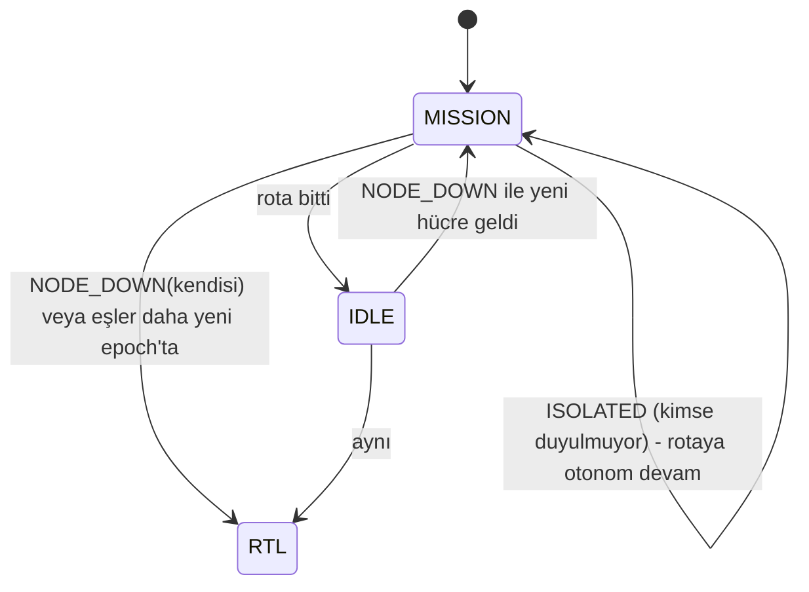
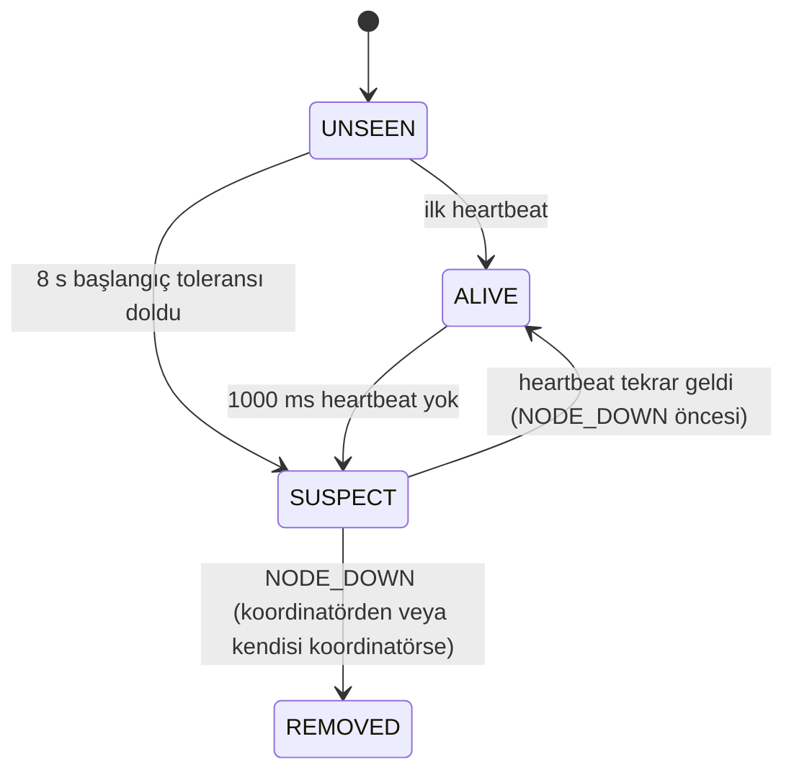

# Arıza Tespiti ve Yeniden Görev Dağıtımı

## 1. Düğüm Durum Makinesi



## 2. Eş Durumu



## 3. Koordinatör Kuralı

`koordinatör = min { i : i ∈ alive_mask ∧ i ∉ suspect_mask }`

* Ek seçim mesajı yoktur; herkes kendi görüşüne göre hesaplar.
* Koordinatör düşerse (ör. İHA-1), diğerleri onu şüpheli işaretler ve İHA-2 otomatik olarak koordinatör olur.
* Yalnızca koordinatör `NODE_DOWN` yayınlar ⇒ birden fazla arızada bile **uygulama sırası tektir**.

### İzolasyon koruması
Bir düğüm **tüm** eşlerini şüpheli görüyorsa, en olası açıklama kendi linkinin karıştırılmasıdır.
Bu durumda koordinatör olsa bile kimseyi sürüden çıkarmaz; aksi halde jamming altındaki tek bir İHA
sağlam sürünün tamamını "düşmüş" ilan ederdi.

Ek iki kural aynı riski kapatır:
* **Yakın zamanda duyma şartı:** Bir düğüm, son 400 ms içinde en az bir eşten heartbeat almadıysa
  kimseyi sürüden çıkaramaz (alıcısı karıştırılan düğüm zaten kimseyi duymaz).
* **Bekleme süresi (hold-off):** İzolasyon bittikten sonra 2 s boyunca çıkarma yapılmaz; bu sürede tüm
  eşlerin heartbeat'leri gelir ve görüş netleşir. Eşler daha yeni bir epoch'taysa düğüm RTL'ye geçer.

Bedeli: 2 düğümlü sürüde veya eşlerin çoğu aynı anda düştüğünde hayatta kalan tek düğüm yeniden
dağıtım yapamaz; bu durumda kendi rotasına devam eder.

## 4. Yeniden Dağıtım (pseudo-code)

```text
reassign(plan, failed, failed_done):
    orphans ← plan.route[failed][failed_done : count[failed]]
    count[failed] ← failed_done            # geçmiş korunur
    alive_mask ← alive_mask \ {failed}
    epoch ← epoch + 1
    for c in orphans (rota sırasıyla):
        best ← argmin_{n ∈ alive} ( dist(tail(n), center(c)) + W · count[n] · cell )
               (eşitlikte küçük ID)
        route[best].append(c)
```

**Karmaşıklık:** O(|orphans| · |alive|) — 4 İHA, 16 yetim hücre için 48 maliyet hesabı.

### Neden canlı konum kullanılmıyor?
Her düğümün diğerlerinin konumunu gördüğü an farklıdır (heartbeat gecikmesi). Maliyette canlı konum
kullanılsaydı iki düğüm farklı plan üretebilirdi. `tail(n)` ve `count[n]` yalnızca **plan** verisidir ve
plan tüm düğümlerde aynıdır ⇒ sonuç bit düzeyinde aynıdır; `TASK_SYNC` hash'i bunu doğrular.

### Neden rotanın sonuna ekleniyor?
Hayatta kalan İHA'ların **o anki hedefleri değişmez**; ani manevra ve yeniden planlama gerektirmez.
Yetim hücreler boustrophedon sırasında bitişik olduğundan, bir düğümün kuyruğuna eklenen zincir de
çoğunlukla bitişik kalır.

## 5. Örnek (8x8 alan, 4 İHA, İHA-4 5 hücre tamamladıktan sonra düşüyor)

| | İlk plan | Sonra |
|---|---|---|
| İHA-1 | hücre 0–15 (16) | 16 + yetimlerin bir kısmı |
| İHA-2 | hücre 16–31 (16) | 16 + ... |
| İHA-3 | hücre 32–47 (16) | 16 + ... |
| İHA-4 | hücre 48–63 (16) | 48–52 (5, tamamlanmış) |

Toplam: 59 aktif + 5 tamamlanmış = 64 → kapsama korunur (`test_reassign`).

## 6. Zamanlama

| Olay | Süre |
|---|---|
| Heartbeat periyodu | 200 ms |
| Şüpheli eşiği | 1000 ms (5 kayıp) |
| NODE_DOWN → tüm düğümlerde uygulama | 1 TCP mesaj gecikmesi (localhost'ta < 1 ms) |
| Toplam tespit + yeniden dağıtım | ≈ 1,0 – 1,2 s |
