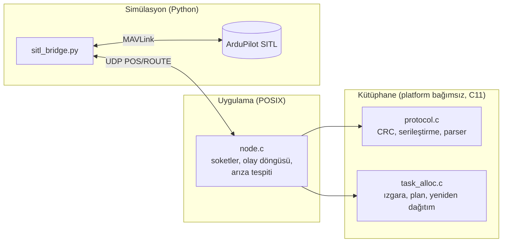

# Mimari

## 1. Gereksinimler

| ID | Gereksinim | Karşılayan |
|---|---|---|
| R1 | Sürü, YKİ bağlantısı olmadan haberleşebilmeli | TCP full-mesh, YKİ yok |
| R2 | Bir İHA kaybı ≤ 2 s içinde tespit edilmeli | 200 ms heartbeat, 1 s timeout |
| R3 | Kayıp İHA'nın görevi kalanlara dağıtılmalı, hücre kaybolmamalı | `adsas_plan_reassign`, `test_reassign` |
| R4 | Tüm İHA'lar aynı planı uygulamalı | koordinatör + deterministik algoritma + `TASK_SYNC` hash |
| R5 | Paketler küçük olmalı (RF bant genişliği) | 31 B binary heartbeat |
| R6 | Jamming altındaki İHA sürüye zarar vermemeli | izolasyon koruması, epoch kontrolü → RTL |
| R7 | Bozuk/eksik veri sistemi kilitlememeli | CRC16 + resync yapan stream parser |

## 2. Modüller

* `protocol.c` ve `task_alloc.c` işletim sistemi çağrısı içermez → doğrudan bir STM32/Linux SBC
  uçuş bilgisayarına taşınabilir. Dinamik bellek kullanılmaz (tüm yapılar sabit boyutlu).
* `node.c` POSIX soketlerine bağlıdır; gerçek donanımda bu katman telsiz modem sürücüsüyle değiştirilir.

## 3. Bellek

| Yapı | Boyut |
|---|---|
| `adsas_plan_t` | 16 × 256 × 2 B + başlık ≈ 8,2 kB |
| `adsas_parser_t` | 78 B arabellek + sayaçlar ≈ 100 B (bağlantı başına) |
| `adsas_frame_t` | 76 B |

## 4. Hata Senaryoları

| Senaryo | Davranış |
|---|---|
| TCP bağlantısı koptu | `send` hatası → soket kapatılır, 1 s'de bir yeniden bağlanma |
| Heartbeat gecikti ama düğüm yaşıyor | SUSPECT; NODE_DOWN yayınlanmadan önce gelirse şüphe kalkar |
| NODE_DOWN kaçırıldı | Sonraki NODE_DOWN'da `EPOCH GAP`; eşler daha yeni epoch'taysa RTL |
| Koordinatör düştü | Bir sonraki en küçük ID koordinatör olur |
| Tüm eşler sessiz | ISOLATED — kimse sürüden atılmaz, rota sürdürülür |
| Bozuk bayt / CRC | Parser çerçeveyi atar, sayaç artar, akış devam eder |
