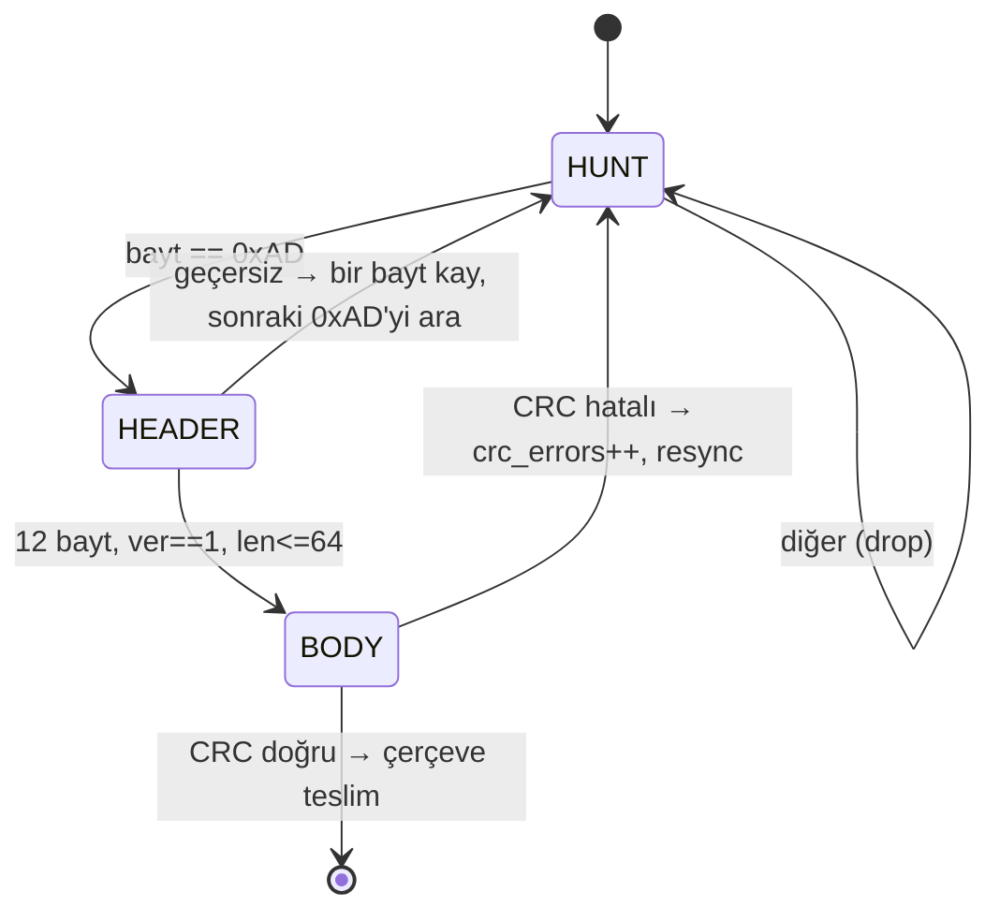

# A.D.S.A.S. Protokol Spesifikasyonu (v1)

## 1. Genel
* Bayt sırası: **little-endian**
* Çerçeve = 12 B başlık + `len` B yük + 2 B CRC
* Maksimum yük: 64 B (`ADSAS_MAX_PAYLOAD`) → maksimum çerçeve 78 B
* Hedef adres `0xFF` = yayın (broadcast)
* Düğüm kimlikleri 1..15 (`alive_mask` 16 bit; bit *i* = düğüm *i*)

## 2. Başlık

| Ofset | Alan | Tip | Açıklama |
|---|---|---|---|
| 0 | `magic` | u8 | Sabit `0xAD` — senkronizasyon baytı |
| 1 | `ver_type` | u8 | Üst 4 bit sürüm (`1`), alt 4 bit mesaj tipi |
| 2 | `src` | u8 | Gönderen düğüm |
| 3 | `dst` | u8 | Hedef düğüm, `0xFF` yayın |
| 4 | `seq` | u16 | Gönderen başına artan sıra no (kayıp tespiti için) |
| 6 | `len` | u16 | Yük uzunluğu |
| 8 | `t_ms` | u32 | Gönderenin başlangıçtan beri geçen süresi (ms) |

## 3. Mesajlar

### 3.1 HEARTBEAT (tip 1, 17 B, 5 Hz)

| Ofset | Alan | Tip | Birim |
|---|---|---|---|
| 0 | `state` | u8 | 0 IDLE, 1 MISSION, 2 RTL, 3 DEGRADED |
| 1 | `battery` | u8 | % |
| 2 | `x_dm` | i32 | yerel Doğu, dm |
| 6 | `y_dm` | i32 | yerel Kuzey, dm |
| 10 | `alt_dm` | i16 | dm |
| 12 | `epoch` | u16 | düğümün uyguladığı plan sürümü |
| 14 | `cells_done` | u16 | kendi rotasında tamamlanan hücre |
| 16 | `flags` | u8 | bit0 GPS bozuk, bit1 harici konum (SITL) |

### 3.2 NODE_DOWN (tip 2, 10 B) — yalnızca koordinatör gönderir

| Ofset | Alan | Tip | Açıklama |
|---|---|---|---|
| 0 | `node_id` | u8 | düşen düğüm |
| 1 | `reason` | u8 | 1 heartbeat zaman aşımı, 2 link kapandı |
| 2 | `new_epoch` | u16 | uygulandıktan sonraki epoch (= mevcut + 1) |
| 4 | `cells_done` | u16 | düşen düğümün son bildirdiği ilerleme |
| 6 | `last_seen_ms` | u32 | son heartbeat zamanı |

Alıcı kuralı: `new_epoch == epoch + 1` ise uygula; daha büyükse **EPOCH GAP** (kaçırılmış mesaj) logla;
küçük/eşitse yok say (zaten uygulandı). `node_id` alıcının kendisiyse → RTL.

### 3.3 TASK_SYNC (tip 3, 8 B)

| Ofset | Alan | Tip |
|---|---|---|
| 0 | `epoch` | u16 |
| 2 | `alive_mask` | u16 |
| 4 | `plan_hash` | u32 (FNV-1a: epoch, mask, tüm rotalar) |

## 4. CRC
CRC-16/CCITT-FALSE: polinom `0x1021`, başlangıç `0xFFFF`, yansıtma yok, son XOR yok.
Kapsam: başlık + yük. Kontrol değeri: `"123456789"` → `0x29B1`.

## 5. Stream Parser Durum Makinesi

Resync sırasında arabellekteki **bir sonraki `0xAD`** baytına kaydırılır; böylece bozuk bir çerçevenin
içine gömülmüş geçerli bir çerçeve başlangıcı kaybedilmez. İstatistikler: `frames_ok`, `crc_errors`,
`bytes_dropped`.

## 6. Bant Genişliği Bütçesi (4 düğüm)

| Kalem | Hesap | Sonuç |
|---|---|---|
| Heartbeat / düğüm | 31 B × 5 Hz × 3 eş | 465 B/s |
| Tüm sürü | 465 × 4 | **1,86 kB/s** |
| Karşılaştırma: JSON | 184 B × 5 × 3 × 4 | 11 kB/s |

TCP/IP başlıkları (40 B) simülasyon ortamına aittir; gerçek telsiz linkinde bu katman olmayacağı için
uygulama protokolünün kendi boyutu belirleyici olur.
